# SpareSpark

**When the exact part is gone, find the part that works.**

When an industrial robot fails, the exact OEM spare part is often out of stock, obsolete or superseded. The knowledge of what else works lives in technician notes, old work orders, maintenance history and the knowledge base, not in the inventory system. Technicians get dispatched with the wrong part, first-time fix rates drop and SLAs are missed.

SpareSpark is a standalone maintenance application that closes that gap with a small team of agents and a human in the loop:

| Who | Role |
|---|---|
| **Triage Agent** | Reads the robot's fault code and identifies the failed component and part number. |
| **Spare Parts Agent** | Checks inventory for the exact part. If there is none, mines maintenance knowledge for superseded or substitute parts and cites every source. |
| **Logistics Parts Coordinator** (human) | Reviews the evidence, chats with the Spare Parts Agent, and approves or rejects a substitute. |
| **Procurement Agent** | When nothing usable is in stock, drafts a purchase order for the part (or its documented successor). |
| **Procurement Coordinator** (human) | Approves or rejects the purchase order. |
| **Warehouse Receiving** (human) | Receives the vendor's delivery, which adds stock and restarts the repair. |
| **Resolution Agent** | Reserves the part, creates the work order, dispatches the technician with installation notes, and closes the ticket with first-time-fix and SLA results. |

SpareSpark has **no dependency on ServiceNow**. An optional [ServiceNow connector](#servicenow-connector) links it to a ServiceNow instance.

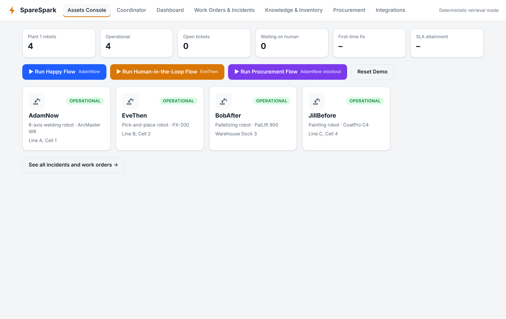

---

## Contents

- [Quick start](#quick-start)
- [The three demo flows](#the-three-demo-flows)
  - [1. Happy flow: exact part in stock](#1-happy-flow-exact-part-in-stock)
  - [2. Human-in-the-loop flow: substitute found in maintenance knowledge](#2-human-in-the-loop-flow-substitute-found-in-maintenance-knowledge)
  - [3. Procurement flow: nothing in stock](#3-procurement-flow-nothing-in-stock)
- [Screens](#screens)
- [How the Spare Parts Agent decides](#how-the-spare-parts-agent-decides)
- [Workflow and stages](#workflow-and-stages)
- [Architecture](#architecture)
- [API](#api)
- [ServiceNow connector](#servicenow-connector)
- [Configuration](#configuration)
- [Tests](#tests)
- [Project layout](#project-layout)
- [Limits](#limits)

---

## Quick start

Requires **Node.js 22.13 or later**. No database server or other dependencies are needed.

```bash
git clone https://github.com/somul18/SpareSpark_v1.git
cd SpareSpark_v1
npm install        # optional: installs the Claude SDK for LLM explanations
npm start          # http://localhost:3000
```

On first start SpareSpark creates `data/sparespark.db` (SQLite) and seeds it with the demo plant: four robots, eight spare parts, three vendors, and ten maintenance records written the way technicians really write them. Databases created by an earlier version upgrade themselves on start and keep their stock levels.

With Docker:

```bash
docker build -t sparespark .
docker run -p 3000:3000 -v sparespark:/data sparespark
```

---

## The three demo flows

The Assets Console has one button per flow. Each button reports a fault on a robot, opens the workflow popup, and lights up the steps as the agents work. The whole demo runs in under three minutes, and **Reset Demo** puts robots, stock, incidents and purchase orders back to the start (knowledge records are kept).

### 1. Happy flow: exact part in stock

**Robot:** AdamNow, 6-axis welding robot, Line A Cell 1. **Fault:** `J3-OVERCURRENT`.

| Step | Who | What happens |
|---|---|---|
| 1 | Robot | AdamNow reports `J3-OVERCURRENT`; an incident is created and the robot turns red (Fault). |
| 2 | Triage Agent | Maps the fault code to the **Joint 3 servo motor, part SM-400-J3**. |
| 3 | Spare Parts Agent | Finds an **exact match**: 2 on hand in bin A-14. No approval needed. |
| 4 | Resolution Agent | Reserves 1 unit (inventory shows it as reserved, so no one else can take it). |
| 5 | Resolution Agent | Creates work order SSWO…, assigns M. Ortiz, and attaches the installation notes from the inventory record and KB0010101 ("re-home joint 3 and run encoder calibration"). |
| 6 | Technician | Robot goes amber (Under Repair). In the demo, the repair confirmation is simulated after a few seconds. |
| 7 | Resolution Agent | Incident resolved: **Right part dispatched, First-Time Fix = Yes, SLA = Met**. Robot shows Restored. |

<p>
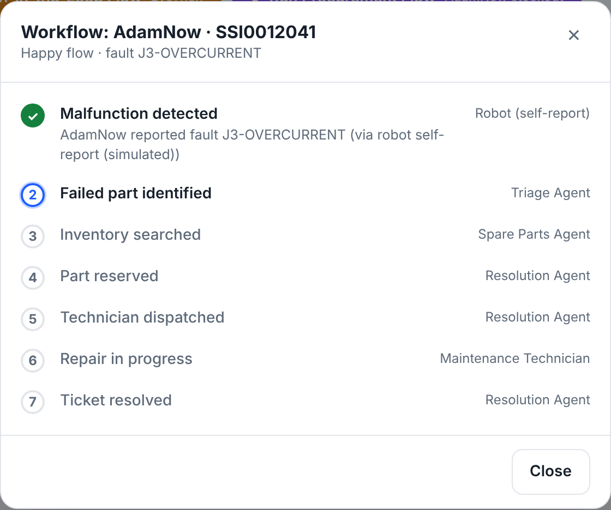
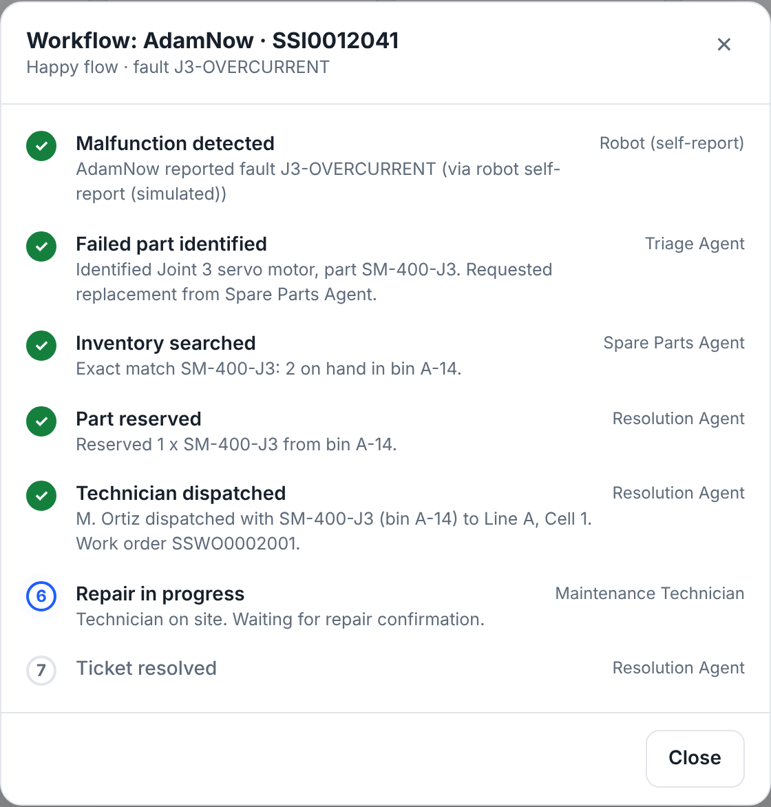
</p>

### 2. Human-in-the-loop flow: substitute found in maintenance knowledge

**Robot:** EveThen, pick-and-place robot (model PX-200), Line B Cell 2. **Fault:** `W-GEAR-BACKLASH`.

This is the flow SpareSpark exists for. Inventory says the part is dead; the maintenance records know better.

| Step | Who | What happens |
|---|---|---|
| 1 | Robot | EveThen reports `W-GEAR-BACKLASH`. |
| 2 | Triage Agent | Identifies the **wrist gear reducer, part GR-220-W**. |
| 3 | Spare Parts Agent | Inventory: GR-220-W is **Obsolete with 0 on hand**, and inventory does not list a replacement. |
| 4 | Spare Parts Agent | Searches all 10 maintenance records. Finds 8 relevant ones, including entries that call the part "wrist gearbox", "GR220W reducer" and "wrist red. W". |
| 5 | Spare Parts Agent | Recommends **GR-220-W2** as a **Documented Supersession** (3 available, bin B-12), citing TN-0042 (technician note), WO-1187 (work order on a sister robot), MH-2207 (maintenance history) and KB0010334 (the 2025 OEM bulletin). Quotes the **two extra shims** installation note. |
| 6 | Spare Parts Agent | Also lists **GR-225-W** as a lower-confidence *Potential Alternative* (one tentative note, not listed for PX-200) and **excludes GR-230-W** because TN-0061 says it "does not fit, wrong bolt pattern". |
| 7 | Workflow | **Pauses** at *Awaiting Human Approval*. EveThen shows "Waiting on Logistics Coordinator" and the Coordinator tab gets an alert. |
| 8 | Coordinator (human) | Opens the alert, reads the evidence, optionally chats with the agent ("Why not GR-225-W?"), and clicks **Select this part** on GR-220-W2. The approval is stored on the incident. |
| 9 | Resolution Agent | Reserves 1 x GR-220-W2 from bin B-12, dispatches the technician with all four shim/installation notes and their sources. |
| 10 | Resolution Agent | Incident resolved with First-Time Fix = Yes; robot Restored. The dashboard's *Parts recovered by AI* goes up by one. |

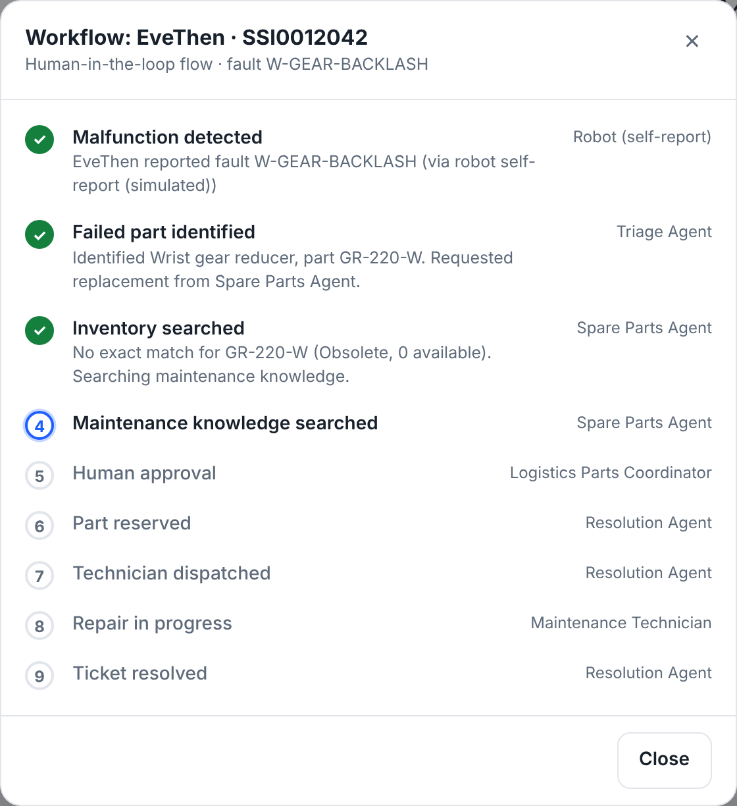

The coordinator sees the recommendation with its evidence, the alternatives, what was excluded and why, and which wording matched in each record:

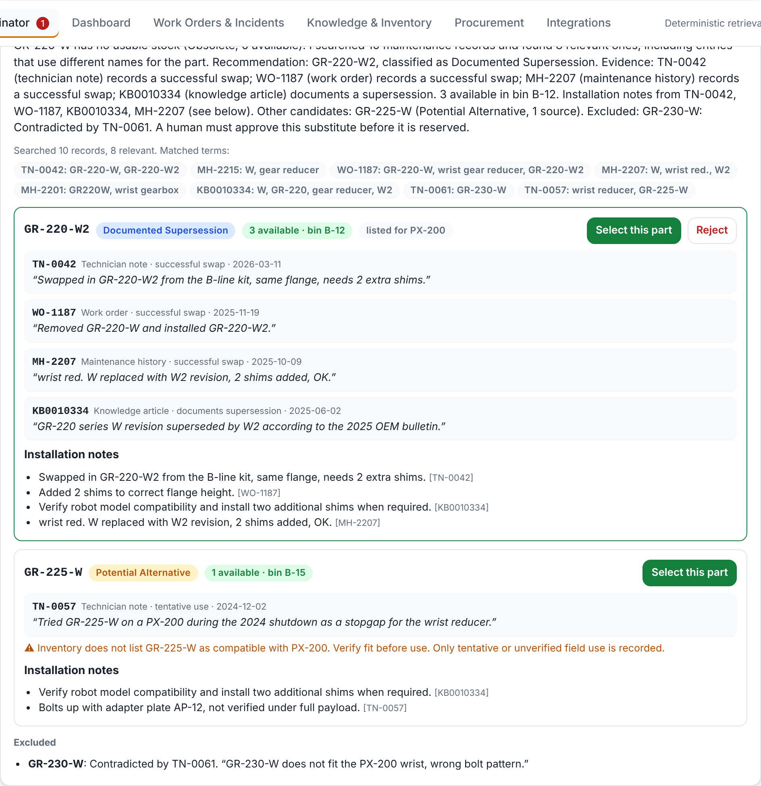

The coordinator can question the agent. Answers only use the retrieved records:

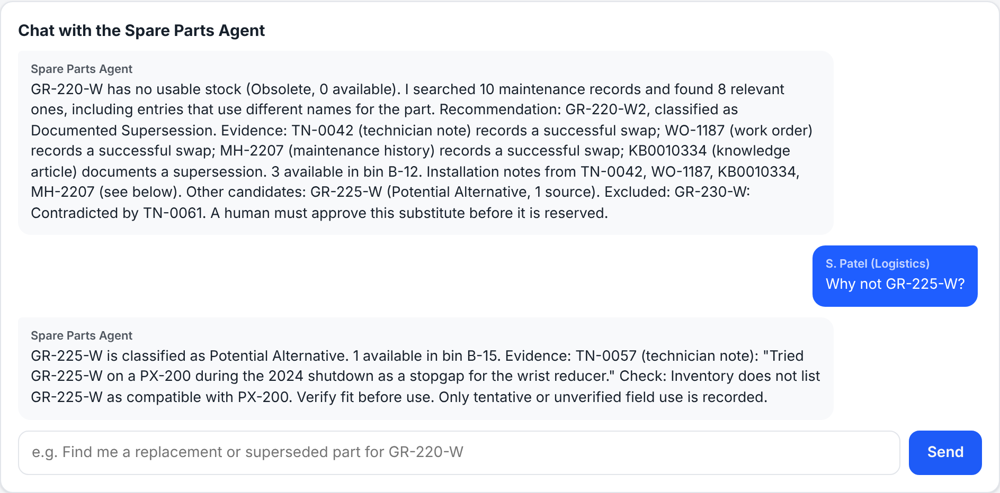

After approval the workflow resumes and completes:

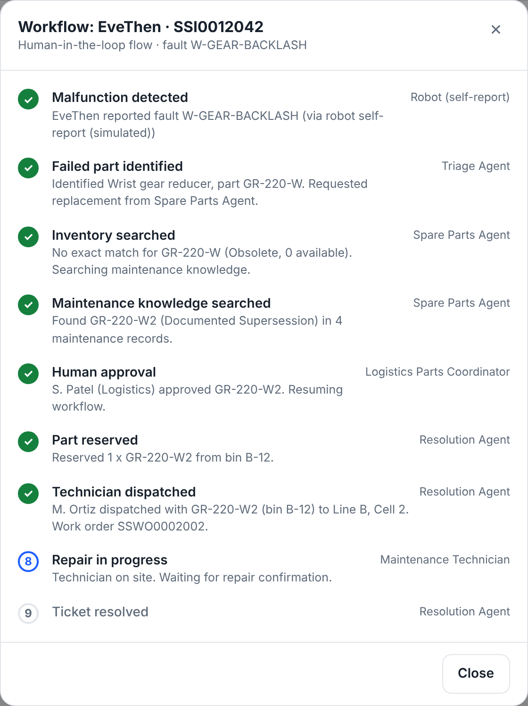

**If the coordinator rejects** the recommendation, the agent proposes the next candidate (GR-225-W, with its warnings). If every candidate is rejected or out of stock, the incident is handed to the Procurement Agent (flow 3), which orders the documented successor when the original part is obsolete.

### 3. Procurement flow: nothing in stock

**Robot:** AdamNow. **Fault:** `J3-OVERCURRENT`, with SM-400-J3 out of stock.

The button simulates a stockout first. You reach the same place without the simulation by running the happy flow three times: the first two runs use both servos in stock, and the third has none.

| Step | Who | What happens |
|---|---|---|
| 1-3 | Robot, Triage, Spare Parts | Same as the happy flow, but SM-400-J3 has **0 available**. |
| 4 | Spare Parts Agent | Searches maintenance knowledge: no in-stock substitute with supporting evidence. Hands over to procurement instead of failing. |
| 5 | Procurement Agent | Looks up sourcing for the part and drafts **PO 2 x SM-400-J3 from Apex Robotics Supply, $3,700, 3-day lead time**. Orders the reorder quantity, not just one, so stock is rebuilt. |
| 6 | Workflow | **Pauses** at *Awaiting PO Approval*. AdamNow shows "Waiting on Procurement approval" and the Procurement tab shows a badge. |
| 7 | Procurement Coordinator (human) | Clicks **Approve** in the popup or the Procurement tab. The PO becomes *Ordered* with an expected delivery date. (Reject sends the incident to *Needs Attention*.) |
| 8 | Vendor | Ships the order with a tracking number. In the demo this is simulated a few seconds after approval; in production the vendor or ERP calls `POST /api/purchase-orders/:id/ship`. |
| 9 | Warehouse Receiving (human) | Clicks **Receive** and confirms the quantity. Stock is added to bin A-14 and **one unit is reserved for the waiting incident in the same step**. |
| 10-12 | Resolution Agent | Dispatches the technician, the repair is confirmed, and the incident resolves with "procured on PO…". Procurement KPIs update. |

<p>
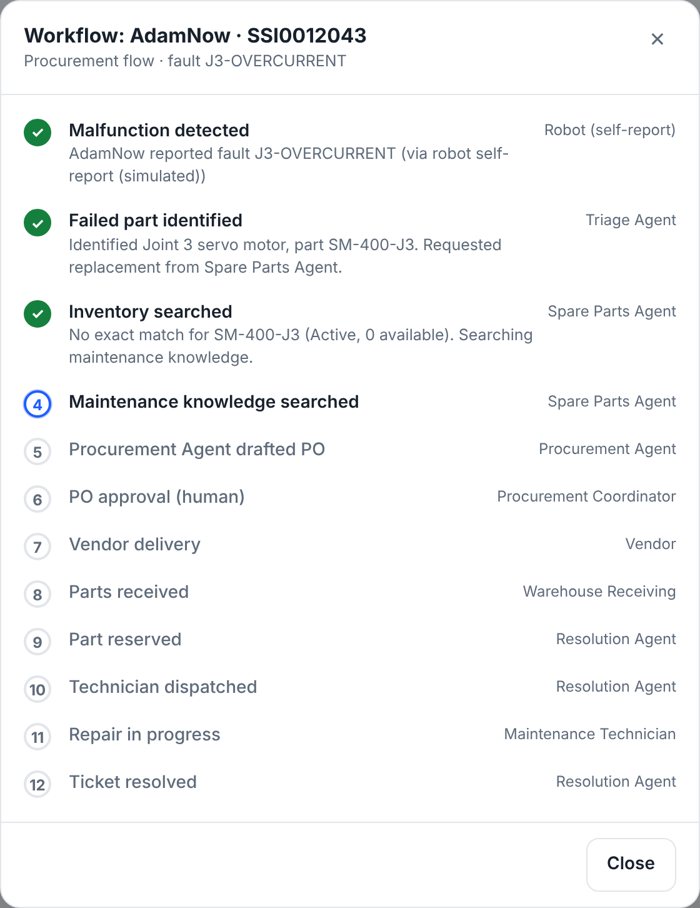
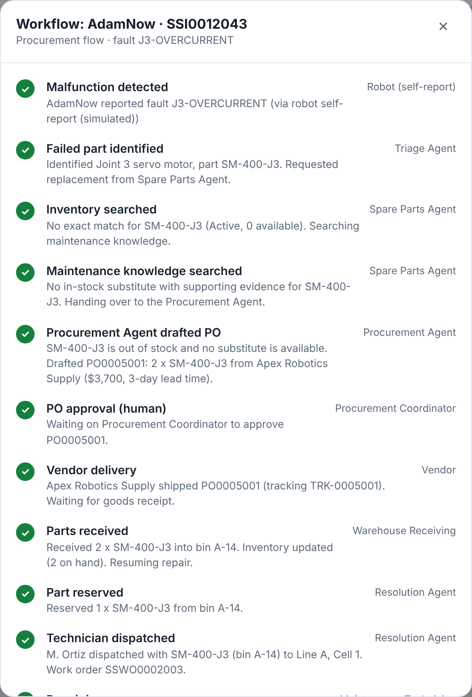
</p>

How the parts come in, on the Procurement tab:

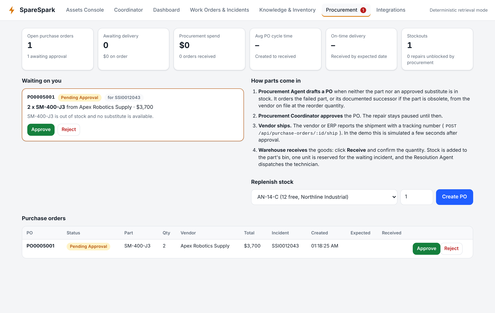

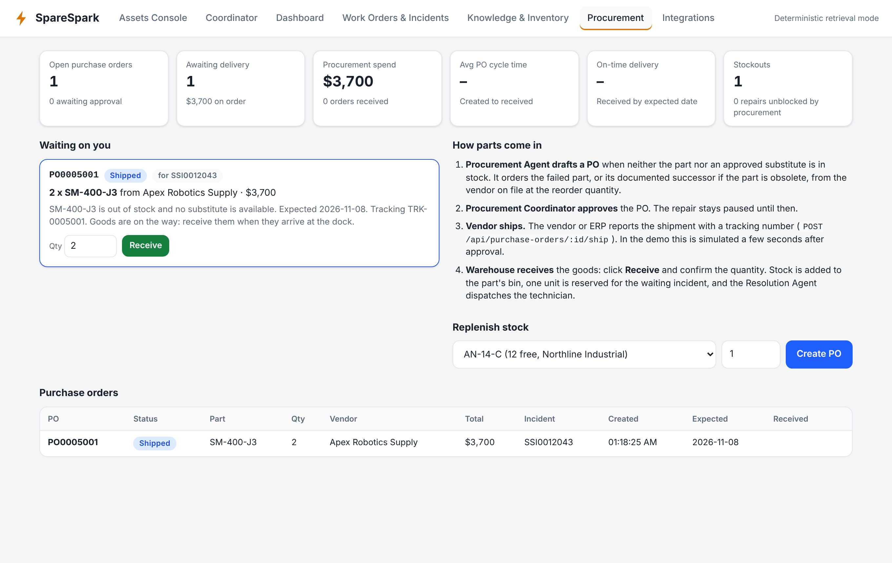

---

## Screens

### Assets Console (Plant Manager)

KPI strip, the three demo buttons, one card per robot with its live status (green Operational/Restored, red Fault, amber Under Repair or waiting), the open incident, the part used, and First-Time Fix / SLA badges. Clicking a robot with an incident reopens its workflow popup. **See all incidents and work orders** jumps to the Work Orders & Incidents tab.

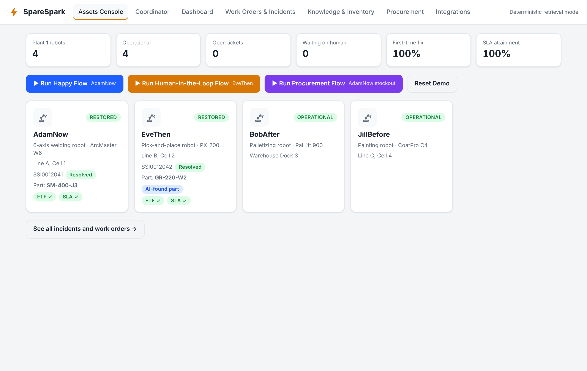

### Workflow popup

Opens when a demo button is clicked. Each step shows its status (done, in progress, waiting on a human or vendor, pending), the agent or person responsible, and the latest action. It polls once a second, so steps light up as the incident's stage changes. When the workflow waits on a person, the popup offers the action directly (open the coordinator view, or approve/receive a PO).

### Coordinator (Logistics Parts Coordinator)

Alerts for incidents waiting on a part decision, the Spare Parts Agent's recommendation with evidence cards, **Select this part** / **Reject** buttons, a chat with the agent, and a full agent activity log showing every decision and tool call.

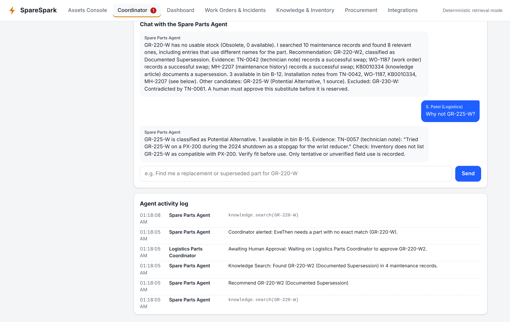

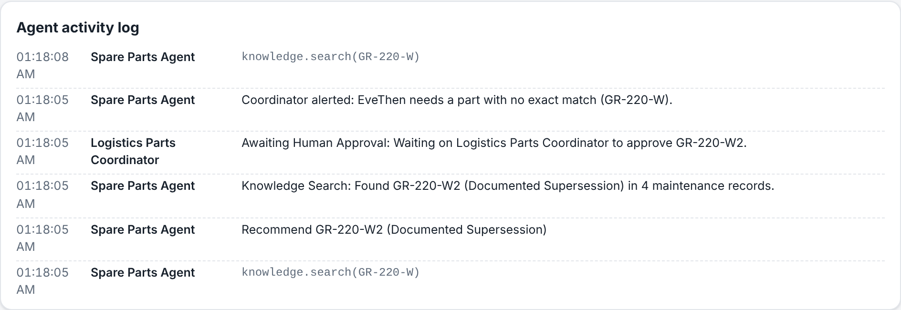

### Dashboard (VP of Operations)

Operational KPIs (open robot incidents, first-time fix rate, SLA attainment, parts recovered by AI from unstructured data), procurement KPIs (open POs, awaiting delivery and value on order, spend, average PO cycle time, on-time delivery, stockouts and repairs unblocked by procurement). Every number is computed from the application's own records.

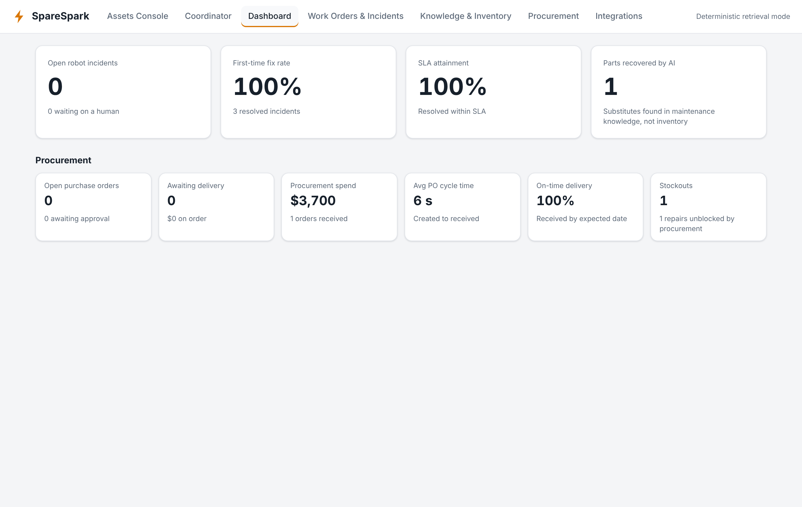

### Work Orders & Incidents

Incidents and work orders in one place. A KPI strip shows open, waiting and resolved incidents and active and completed work orders. The **Incidents** table lists every incident with its stage, failed and selected part, match type, First-Time Fix, SLA and its work order. The **Work orders** table lists every dispatch the Resolution Agent created, with technician, part, bin, location, status and the installation instructions it quoted from the knowledge records. Clicking a row in either table opens that incident's workflow popup.

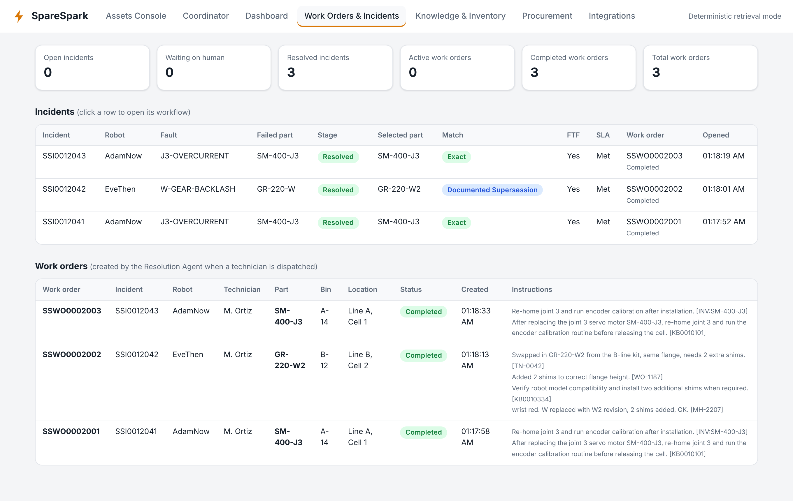

### Knowledge & Inventory

The structured inventory (on hand, reserved, on order, bin, status, vendor and unit cost) next to the unstructured maintenance records. **Try a lookup** runs the Spare Parts Agent on any part number, outside of an incident.

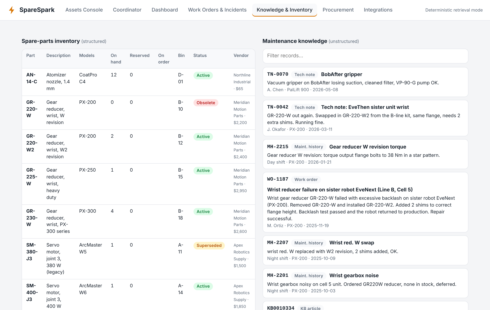

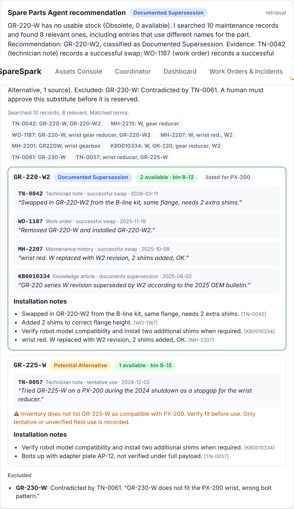

### Procurement

POs waiting on you (approve, reject, mark shipped, receive with quantity), the four-step explanation of how parts come in, a form to create a replenishment PO, and the full purchase order history.

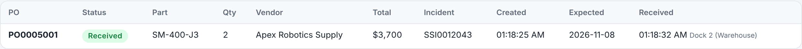

### Integrations

Server settings (API key, webhook, LLM, demo mode), the ServiceNow install steps, and a log of outbound webhooks.

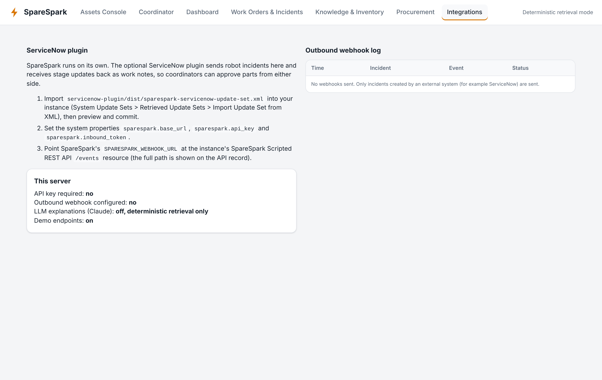

### Phone layout

The console works at phone width; cards and KPIs stack.

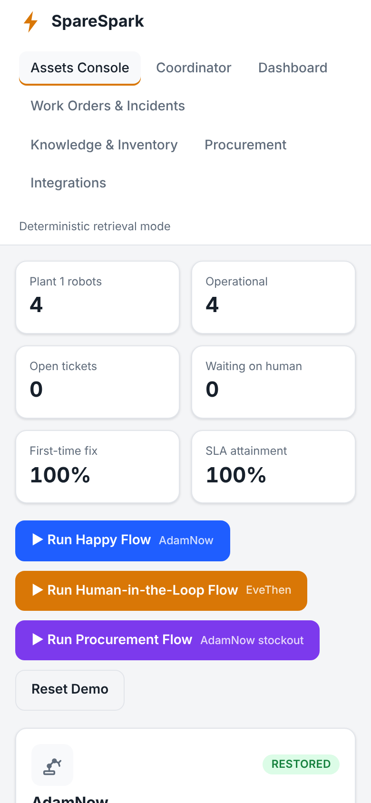

---

## How the Spare Parts Agent decides

The engine is in [`server/knowledge.js`](server/knowledge.js). It contains no demo answers: change the stock or the records and the recommendation changes (there is a test for exactly that).

1. **Exact match.** If the requested part has free stock (on hand minus reserved) and is not obsolete, it is an **Exact** match and no approval is needed.
2. **Find relevant records.** Otherwise every knowledge record is checked for:
   - the part number written loosely: `GR-220-W`, `GR220W`, `gr 220 w`;
   - the part family: `GR-220 series`;
   - bare revisions in context: "W revision superseded by **W2**" resolves to GR-220-W2, but only if that part exists in inventory;
   - component synonyms from the synonyms table: *wrist gearbox*, *wrist reducer*, *wrist red.*, *gear reducer*;
   - other inventory parts of the same kind on the same robot model (which is how TN-0061 about GR-230-W is found).
3. **Extract candidates and relationships.** Each sentence that mentions another part is classified as a **supersession** ("superseded by"), a **successful swap** ("swapped in… running fine", "installed… repair successful"), **tentative use** ("tried… stopgap… not verified"), or a **contradiction** ("does not fit", "wrong bolt pattern").
4. **Classify** each candidate, with no made-up percentages:
   - **Documented Supersession**: a KB article or the inventory record documents it;
   - **Potential Alternative**: field evidence only, flagged with warnings (not listed as compatible, only tentative use, conflicting reports);
   - **Insufficient Evidence**: contradicted or unsupported, so it is excluded and the reason is shown.
5. **Rank** by classification, free stock, whether inventory lists the part for this robot model, number of supporting sources, and number of confirmed field swaps.
6. **Installation notes** are quoted from the supporting records, the inventory record and KB articles about the part family, each with its source.

Every claim carries the record it came from, and the activity log records each tool call (`inventory.lookup`, `knowledge.search`, `inventory.reserve`, `work_order.create`, `sourcing.lookup`).

**Optional Claude layer.** With `ANTHROPIC_API_KEY` set and `npm install` run, Claude (`claude-opus-5-5` by default; set `SPARESPARK_MODEL` to change it) writes the explanation and the chat answers from the retrieved evidence only. Any answer that mentions a part or source not in the evidence, or a percentage, is discarded and the deterministic text is used instead. The header shows which mode is active. Without a key, everything works in deterministic retrieval mode. The Claude path has not yet been run against the live API.

---

## Workflow and stages

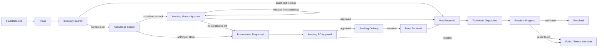

- **Persisted.** The stage lives on the incident row. After a restart, in-flight workflows resume; those waiting on a person keep waiting.
- **Logged.** Every stage change, decision, tool call and human action goes to the event log, shown in the Coordinator view.
- **No duplicates.** Reservations are transactional, with one reservation, one work order and one open purchase order per incident. A robot cannot get a second open incident, and incidents from external systems are de-duplicated by their external reference.
- **Demo simulation kept separate.** The scenario buttons, the simulated stockout, the simulated vendor shipment and the simulated repair confirmation are all in [`server/demo.js`](server/demo.js), and they apply only to incidents created by the demo buttons. `SPARESPARK_DEMO=off` disables them. Real incidents wait for real confirmations.

---

## Architecture

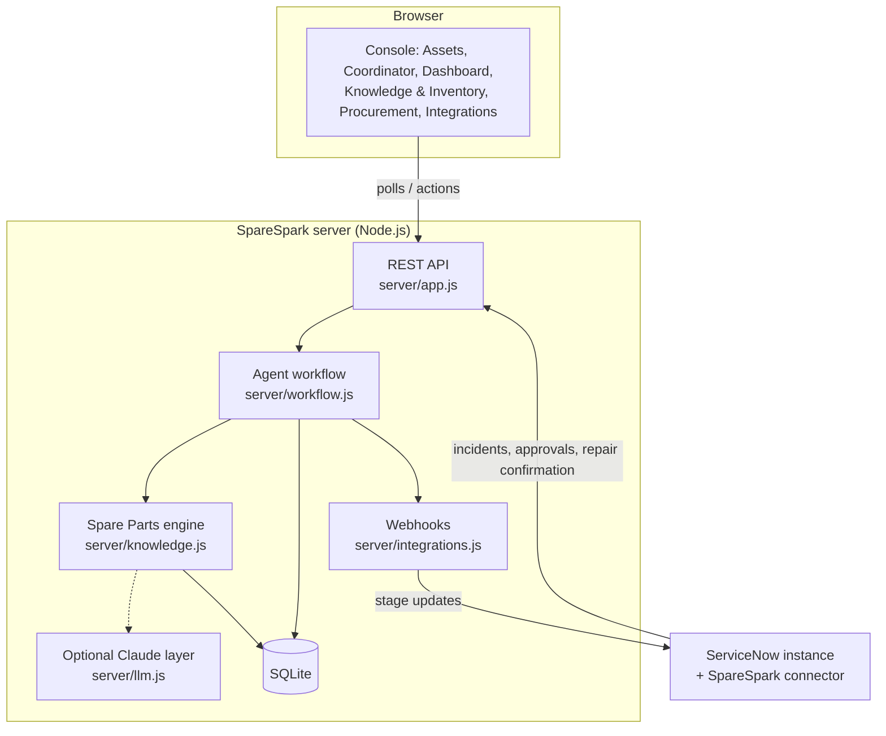

- **Server:** plain `node:http` and `node:sqlite`. No framework and no native modules.
- **Data model:** robots, fault codes, parts, vendors, purchase orders, knowledge records, synonyms, technicians, incidents, reservations, work orders, events, chat messages, webhook log. The schema is in [`server/db.js`](server/db.js) and the seed data in [`server/seed.js`](server/seed.js).
- **Console:** vanilla HTML, CSS and JS in [`public/`](public), with light and dark themes and responsive layout.

---

## API

All endpoints are JSON under `/api`. Set `SPARESPARK_API_KEY` to require an `X-API-Key` header (the console asks for the key once).

### Incidents

| Method | Path | Purpose |
|---|---|---|
| POST | `/incidents` | Report a fault: `{ robot_name, fault_code, external_system?, external_ref?, external_number? }`. Idempotent per `external_system` + `external_ref`. |
| GET | `/incidents` | List incidents (`?open=true` for open ones). |
| GET | `/incidents/:id` | One incident with progress, recommendation, purchase order, work order and event log. `:id` can be the numeric id, the SpareSpark number or the external number. |
| POST | `/incidents/:id/approve` | `{ part_number?, approver?, comment? }` approves the recommended part or another candidate. |
| POST | `/incidents/:id/reject` | `{ part_number?, approver?, comment? }` |
| POST | `/incidents/:id/confirm-repair` | `{ success, notes?, confirmed_by? }` |
| GET/POST | `/incidents/:id/chat` | Coordinator chat with the Spare Parts Agent: `{ text, author? }`. |
| GET | `/notifications` | Incidents waiting on the coordinator. |

### Procurement

| Method | Path | Purpose |
|---|---|---|
| GET | `/purchase-orders` | List POs (`?status=Pending Approval`, `Ordered`, `Shipped`, `Received`, `Rejected`). |
| POST | `/purchase-orders` | Create a replenishment PO: `{ part_number, qty, requested_by?, reason? }`. |
| GET | `/purchase-orders/:id` | One PO (id or number). |
| POST | `/purchase-orders/:id/approve` | `{ approver?, comment? }` sends it to the vendor and sets the expected date. |
| POST | `/purchase-orders/:id/reject` | `{ approver?, comment? }` |
| POST | `/purchase-orders/:id/ship` | Vendor or ERP shipment notice: `{ tracking_ref? }` |
| POST | `/purchase-orders/:id/receive` | Goods receipt: `{ qty?, received_by? }` adds stock and resumes the waiting repair. |
| GET | `/vendors` | Vendors and lead times. |

### Reference data and integration

| Method | Path | Purpose |
|---|---|---|
| POST | `/recommendations` | Stateless lookup: `{ part_number, robot_model? }` returns the full recommendation with evidence. |
| GET/POST | `/knowledge` | List (`?q=`) or upsert knowledge records: `{ ref, source_type, title, body, robot_model?, author? }` where `source_type` is `kb_article`, `work_order`, `tech_note` or `maintenance_history`. |
| GET/POST | `/robots` | List or upsert robots, e.g. from a CMDB: `{ name, model, robot_type?, location?, external_ci_id? }`. |
| GET | `/parts`, `/fault-codes`, `/technicians`, `/work-orders` | Reference data. |
| GET | `/metrics` | Operational and procurement KPIs. |
| GET | `/events`, `/webhooks` | Event log and outbound webhook log. |
| GET | `/health`, `/config` | Health check and server settings (no key required). |
| POST | `/demo/happy`, `/demo/hitl`, `/demo/procurement`, `/demo/reset` | Demo controls. |

**Webhooks.** When `SPARESPARK_WEBHOOK_URL` is set, every stage change on an incident created by an external system is POSTed there as `{ event, sent_at, incident }`, with an `X-SpareSpark-Token` header and optional basic auth. Events: `incident.created`, `incident.stage_changed`, `incident.approval_requested`, `incident.po_approval_requested`.

Example:

```bash
curl -s localhost:3000/api/recommendations -H 'Content-Type: application/json' \
  -d '{"part_number":"GR-220-W","robot_model":"PX-200"}' | jq '.recommended.part_number, .match_type'
# "GR-220-W2"
# "Documented Supersession"
```

---

## ServiceNow connector

SpareSpark runs on its own. The connector in [`servicenow-plugin/`](servicenow-plugin) links it to a ServiceNow instance as one global-scope update set ([`dist/sparespark-servicenow-update-set.xml`](servicenow-plugin/dist/sparespark-servicenow-update-set.xml)).

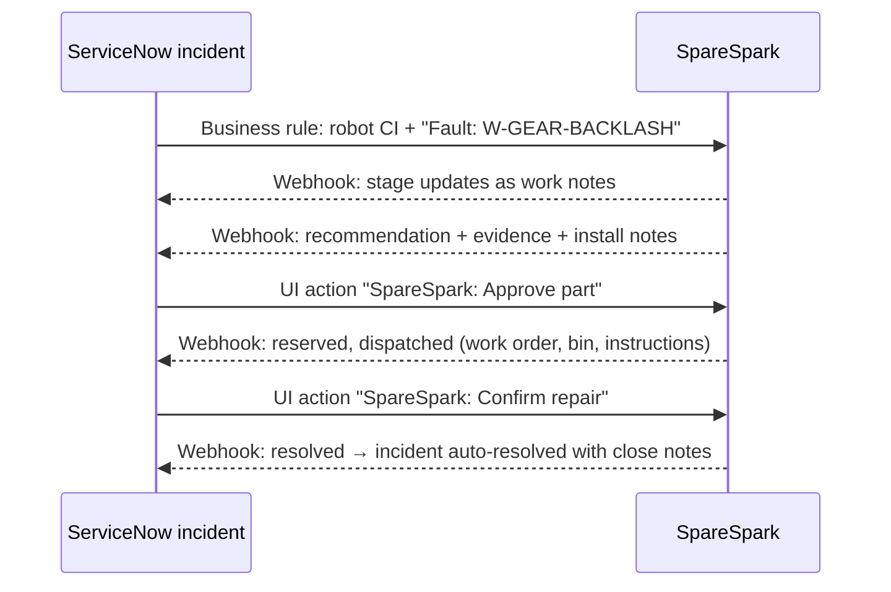

What it adds: a `SpareSparkClient` Script Include, an async Business Rule on incident, UI Actions (*Send to SpareSpark*, *Approve part*, *Reject part*, *Show status*, *Confirm repair*, and *Send to SpareSpark* on published KB articles), a Scripted REST `POST /events` webhook receiver, and `sparespark.*` system properties. The link is kept in the incident's standard `correlation_id` and `correlation_display` fields, so no tables or columns are added. Purchase order status is included in the work notes during procurement.

Install and configuration steps, and what has and has not been verified: [servicenow-plugin/README.md](servicenow-plugin/README.md). The scripts are tested against a live SpareSpark server with a mock of the Glide APIs. They have **not** yet been imported into a real ServiceNow instance. Rebuild the update set with `npm run build:servicenow`.

---

## Configuration

Copy `.env.example` to `.env`; `npm start` loads it automatically.

| Variable | Default | Purpose |
|---|---|---|
| `PORT` | `3000` | HTTP port. |
| `SPARESPARK_DB` | `./data/sparespark.db` | SQLite file (`:memory:` for throwaway). |
| `SPARESPARK_API_KEY` | (none) | Require `X-API-Key` on the API. |
| `ANTHROPIC_API_KEY` | (none) | Turn on Claude explanations and chat answers. |
| `SPARESPARK_MODEL` | `claude-opus-5-5` | Claude model. |
| `SPARESPARK_LLM` | (on when a key is set) | `off` forces deterministic mode. |
| `SPARESPARK_DEMO` | on | `off` hides the demo buttons and disables all simulation. |
| `SPARESPARK_STEP_MS` | `1500` | Pause between agent steps, for a watchable demo. |
| `SPARESPARK_DEMO_REPAIR_MS` | `2500` | Simulated repair confirmation delay (demo incidents only). |
| `SPARESPARK_DEMO_VENDOR_MS` | `3000` | Simulated vendor shipment delay (demo POs only). |
| `SPARESPARK_SLA_MINUTES` | `240` | SLA window for new incidents. |
| `SPARESPARK_WEBHOOK_URL` | (none) | Where stage changes are POSTed (e.g. the ServiceNow `/events` resource). |
| `SPARESPARK_WEBHOOK_TOKEN` | (none) | Sent as `X-SpareSpark-Token`. |
| `SPARESPARK_WEBHOOK_USER` / `_PASSWORD` | (none) | Basic auth for the webhook. |
| `SPARESPARK_WEBHOOK_ALL` | `false` | Also send webhooks for incidents not created by an external system. |
| `SPARESPARK_CORS_ORIGIN` | (none) | Allow a browser app on another origin to call the API. |

---

## Tests

```bash
npm test
```

15 tests cover:
- the exact match;
- GR-220-W2 found from real sources, with messy wording matched and no invented references;
- that the recommendation follows the data rather than a hardcoded answer;
- the happy, human-in-the-loop and procurement flows end to end;
- the happy flow running out of stock and handing over to procurement;
- rejection fallback, and procurement of the documented successor;
- rejection of a PO;
- duplicate prevention and reset;
- the LLM grounding guard;
- the ServiceNow scripts against a live SpareSpark server.

---

## Project layout

```
server/
  index.js            start the server
  app.js              HTTP API, metrics, static files
  db.js, seed.js      SQLite schema, upgrades, seed data
  knowledge.js        Spare Parts Agent engine
  workflow.js         Triage, Spare Parts, Procurement and Resolution agents; stage machine
  llm.js              optional Claude layer with grounding guard
  demo.js             demo scenarios and simulators (kept apart from real actions)
  integrations.js     outbound webhooks
public/               console (index.html, app.js, styles.css)
servicenow-plugin/    connector scripts, update-set builder, built update set
test/                 node:test suites
docs/screenshots/     images used in this README
```

---

## Limits

These are out of scope, as in the PRD:
- real robot telemetry;
- real ERP or procurement integration (vendors and shipping are simulated in the demo; the PO API is ready for an ERP to call);
- a mobile app;
- production security hardening.

The console has no user login; the API key protects the API.

Knowledge search is lexical with synonym tables, which suits short technician text. A vector index could be added behind `recommend()` for larger collections of records.
